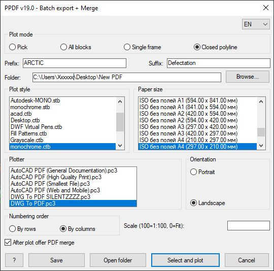
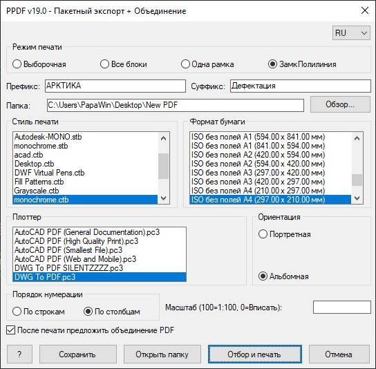

**[Русский](README.md) | English**

# PPDF — Batch PDF Export + Merge for AutoCAD

**PPDF** is a powerful AutoLISP application for AutoCAD (2014 and newer) designed for batch plotting of title-block frames into separate PDF files, with the option to automatically merge them into a single document.

## 🙏 Acknowledgments

The PPDF project evolved thanks to the ideas and architectural decisions from the following open-source projects:

- **[LXPDF](https://github.com/Lynxy039/LXPDF)** (author: [Lynxy039](https://github.com/Lynxy039))  
  *Ideas borrowed:* the concept of batch-exporting frames directly from Model space, the smart sheet-sorting logic (by rows/columns), and the algorithm for selecting blocks inside a closed polyline.

- **[autocad-batch-plot (BPDF)](https://github.com/beastt1992/autocad-batch-plot)** (author: [beastt1992](https://github.com/beastt1992), license: MIT)  
  *Ideas borrowed:* the dialog (DCL) interface structure, automatic detection of the frame block name by mouse click, and a convenient system for saving user settings between sessions.

Huge thanks to the authors for their open code and their contribution to the AutoCAD community! 🚀

---

## 📄 License
This project is distributed under the MIT License. See the [LICENSE](LICENSE) file for details.

## 🚀 Features
* **4 frame selection modes:**
  1. **Manual** — click blocks manually (with undo of the last selection).
  2. **All blocks** — plot all instances of the specified frame block.
  3. **Single frame** — plot only one selected block.
  4. **Closed polyline** — plot all blocks that fall inside the specified closed LWPOLYLINE.
* **Smart sorting:** number sheets by rows (left to right, top to bottom) or by columns.
* **Automatic numbering:** continues the sequence if PDFs already exist in the folder (format `prefix_suffix_NNN.pdf`).
* **PDF merge:** automatically merges all sheets into one file (`prefix_suffix_merged.pdf`) using `pdftk.exe`.
* **Preflight check:** a warning if the target folder already contains PDF files (with options to clear or archive).
* **Settings persistence:** all parameters are saved to `%APPDATA%\PPDF\ppdf_settings.cfg`.

## 📦 Requirements
1. **AutoCAD** 2014 or newer.
2. **pdftk.exe** (only if the PDF merge feature is needed).
   * Download [pdftk Server](https://www.pdflabs.com/tools/pdftk-server/) or [pdftk-java](https://gitlab.com/pdftk-java/pdftk).
   * Place `pdftk.exe` in the AutoCAD support folder (e.g. `C:\Program Files\Autodesk\AutoCAD 20XX\Support\`), in any folder from the Support File Search Path, or simply next to the `PPDF.lsp` file.

## ⚙️ Installation
1. Download the `PPDF.lsp` file from the [Releases](https://github.com/Mozzila-ru/PPDF/releases) section.
2. In AutoCAD, run the `APPLOAD` command (or `_APPLOAD`).
3. Select the `PPDF.lsp` file and click "Load".
4. *(Optional)* Add the script folder to "Trusted Locations" in AutoCAD settings to avoid security warnings.

## 🖨 Usage

1. Run the **`PPDF`** command in the AutoCAD command line.
2. Configure the settings in the dialog:
   * Choose the plotting mode.
   * Specify the prefix, suffix, and output folder.
   * Choose the plotter (recommended: `DWG To PDF.pc3`), plot style, and paper size.
   * Set the scale (empty or `0` = Fit).
3. Click **"Select and Print"**.
4. Follow the command-line prompts to select frames.
5. When plotting is complete, the script will offer to merge the files into a single PDF.

> 💡 **"Silent printing" tip:** If a PDF viewer opens automatically when plotting, click the **"?"** button -> **"Silent printing"** in the PPDF window to learn how to disable this behavior in the plotter's PC3 file settings.

## 📂 Where are the settings stored?
Settings are stored in the text file `ppdf_settings.cfg` in the folder:
`%APPDATA%\PPDF\` (usually `C:\Users\YourName\AppData\Roaming\PPDF\`).
The DCL dialog files are also generated there temporarily.

## 📄 License
This project is distributed under the MIT License. See the [LICENSE](LICENSE) file for details.
